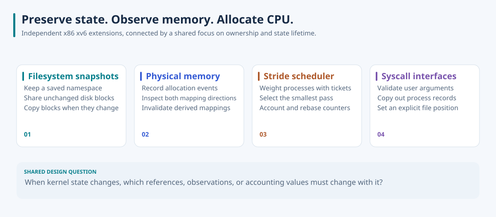
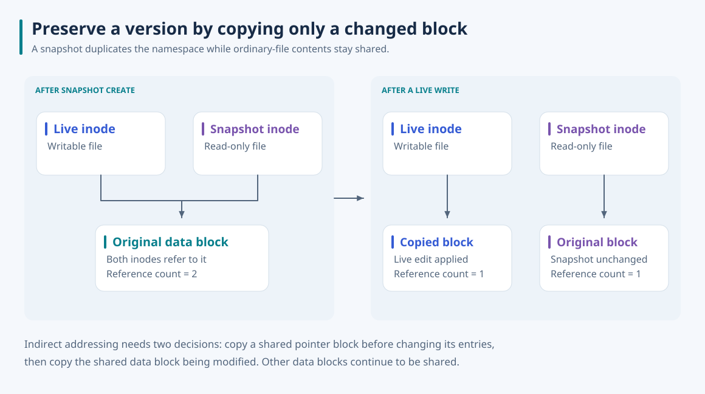
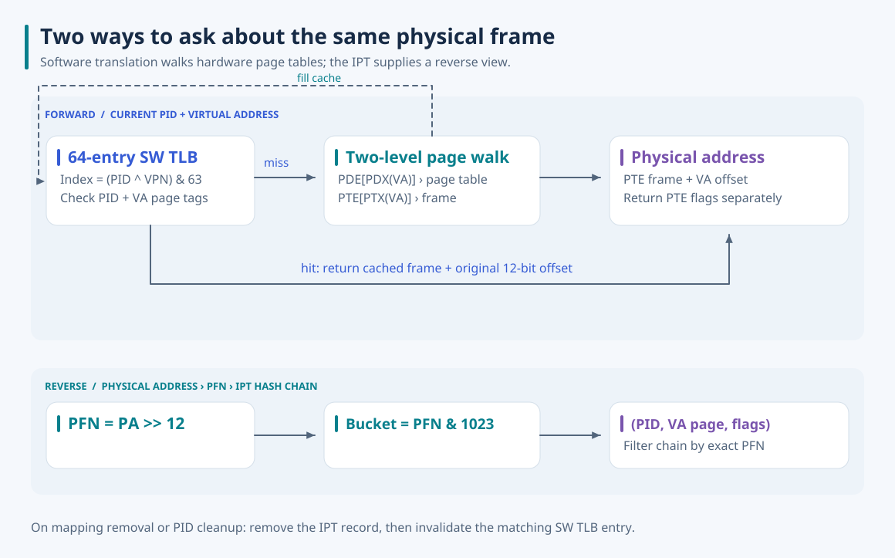
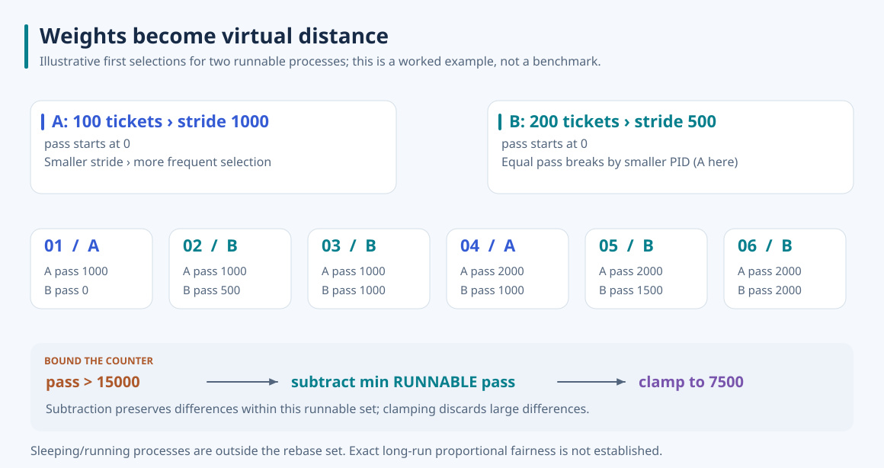

# xv6 Kernel Extensions

**What has to change when a kernel gains saved filesystem versions, observable physical memory, or weighted CPU scheduling?** I extended the x86 xv6 kernel in separate projects to explore that question through working code, shell tools, and execution traces.

The common problem is state lifetime. A saved inode must keep its blocks alive after the live file changes. A reverse mapping and cached translation must respond when a page is removed. A scheduler must account for service without letting its counters grow indefinitely. Each extension puts that responsibility into the kernel paths that create, change, or release the relevant state.



## Explore the projects

Each submodule is an independent xv6 tree. The extensions are not combined into one kernel image. The detailed READMEs explain design decisions, preserve the development reports' call graphs as redesigned SVGs, and distinguish demonstrated behavior from remaining limits.

| Project | What I implemented | Detailed README |
| --- | --- | --- |
| Filesystem snapshots | Block CoW, persistent references, saved trees, rollback and deletion | [os-p4-snapshot](https://github.com/jaeunda/os-p4-snapshot#readme) |
| Physical memory | Frame allocation records, forward/reverse mapping, software translation cache | [os-p3-pageframe](https://github.com/jaeunda/os-p3-pageframe#readme) |
| Stride scheduler | Minimum-pass selection, ticket weights, rebasing, child tick budgets | [os-p2-scheduler](https://github.com/jaeunda/os-p2-scheduler#readme) |
| Syscall interfaces | Process records and integer calls; an earlier file-positioning extension | [os-p1-syscall](https://github.com/jaeunda/os-p1-syscall#readme) · [xv6-syscall / lseek](https://github.com/jaeunda/xv6-syscall#readme) |

The [Linux observation notes](docs/linux-observations.md) connect the initial process, memory, descriptor, and disk measurements to these kernel questions. Original Word reports and extracted screenshots are not stored in the repositories. Figures use a shared visual style and outlined Noto Sans so their typography is consistent on GitHub; the [font license](docs/assets/NotoSans-OFL.txt) is included.

## Build and run

Use Linux or WSL with Make, binutils, GCC supporting 32-bit x86 output, and QEMU. Validation used GCC 9 and one virtual CPU. Clone with submodules using your configured GitHub SSH access:

```bash
git clone --recurse-submodules git@github.com:jaeunda/xv6-kernel-extensions.git
cd xv6-kernel-extensions/xv6-snapshot/xv6-public
make CC=gcc-9 xv6.img fs.img
make CC=gcc-9 CPUS=1 qemu-nox
```

The scheduler, pageframe, and process-inspection trees also build inside their `xv6-public` directories. The earlier lseek tree builds directly inside `xv6-lseek`. Exit QEMU with **Ctrl+A, then X**. Each project's README supplies its guest-shell commands and any fixture limitations.

All five trees built and booted during documentation validation. The scheduler's five demo workloads completed, snapshot operations demonstrated sharing and restoration, and the memory tools exposed allocation, translation, and unmapping behavior. Existing pageframe fixture failures and a process-display formatting defect are documented in the corresponding original READMEs; demo completion is not presented as every check passing.

## Filesystem snapshots: preserve a version without duplicating its contents

A full filesystem copy duplicates unchanged bytes every time a version is saved. I separated the saved namespace from its contents: snapshot directories and inodes are rebuilt under `/snapshot/ID`, while ordinary files initially share their direct blocks, indirect pointer block, and indirect data blocks with the live tree.

Persistent per-block reference counts make that sharing safe to release. `balloc` establishes the first reference; cloning adds references; `bfree` returns a block to the bitmap only when the last reference disappears. On a write, `bmap` copies a shared block before updating the live pointer. For indirect addressing, it also makes the shared pointer block private before changing an entry. Unaffected contents remain shared.



Create, rollback, and delete operate on the directory tree through recursive helpers. Saved copies receive read-only modes; rollback rebuilds writable live copies while retaining other snapshots. The superblock preserves the next snapshot ID across normal reboots, and the extended image builder initializes `/snapshot/.brefcnt` alongside the filesystem.

In the QEMU demo, a 6,150-byte file initially had the same direct and indirect block addresses as its snapshot. Appending changed the live indirect pointer and affected data-block address while all direct addresses stayed shared. Rollback restored the saved addresses; deletion removed that version; a restart continued with the next ID. These observations demonstrate the CoW mechanism without claiming a measured performance gain. Crash-atomic large-tree operations and consistent capture under arbitrary concurrent writers remain outside the established behavior.

[Design, complete call graph, CoW and lifecycle diagrams, commands, and results →](https://github.com/jaeunda/os-p4-snapshot#readme)

## Physical memory: connect allocation records to address mappings

The allocator's free list says whether a page is available, but cannot explain the history of an allocated frame or its virtual mappings. I added three complementary views: frame allocation records, a software walk of the current process's page tables, and a PFN-indexed inverted page table that returns recorded PID/VA mappings.

`kalloc` and `kfree` update allocation status, allocation-context PID, and start tick. Mapping hooks populate the IPT; a per-CPU override attributes fork's copied mappings to the child. Heap shrink and process exit remove records and invalidate matching entries in the 64-entry software translation cache. That cache speeds repeated inspection by avoiding another page walk on a hit; it does not replace the hardware TLB.



A fresh-boot stress demo showed frame records for two overlapping processes and an empty filtered dump after release. The translation fixture recorded three hits and four misses, then correctly rejected the released heap address. It also exposed limits: user code pages are writable in this xv6 tree, and fork copies physical pages, so fixtures expecting read-only code or a shared parent frame fail. The source and detailed write-up distinguish allocation context from mapping ownership and explain the remaining coherence boundaries.

[Frame tracking, full memory call graph, translation design, and test findings →](https://github.com/jaeunda/os-p3-pageframe#readme)

## Stride scheduler: turn a process weight into execution order

Round-robin gives runnable processes equal turns. I introduced ticket weights and `stride = 100000 / tickets`, then selected the runnable process with the smallest accumulated pass. Smaller strides advance more slowly and receive more frequent turns; equal passes break by PID. Timer accounting gives the demonstrated child workloads a CPU-tick budget.



The five-workload demo showed equal-ticket children alternating to their budgets, unequal weights changing selection frequency, and low-ticket cases triggering rebasing. Rebase subtracts a runnable baseline and clamps large distances to 7,500. The clamp discards relative-distance information, so these traces do not establish exact long-run proportional fairness. The detailed README includes both report diagrams and explains the prebuilt demo executables.

[Scheduling policy, timer/context-switch call graph, and execution traces →](https://github.com/jaeunda/os-p2-scheduler#readme)

## Syscall interfaces: expose a small operation through the whole boundary

I added `hello_number` and `get_procinfo` to exercise integer arguments, dispatch, process-table lookup, and user-buffer copying. The process handler fills a local record while holding `ptable.lock`, releases the lock, then copies the result to the caller. The demo verifies integer return values and missing-PID handling; its current display-format defect is documented in the [process-inspection README](https://github.com/jaeunda/os-p1-syscall#readme).

The earlier [lseek extension](https://github.com/jaeunda/xv6-syscall#readme) updates the existing open-file offset using `SEEK_SET`, `SEEK_CUR`, or `SEEK_END`. Its small positional-edit demo changes `Hello SSU` to `Hello World` through the ordinary write path. Both original READMEs include custom SVGs and implementation boundaries.
