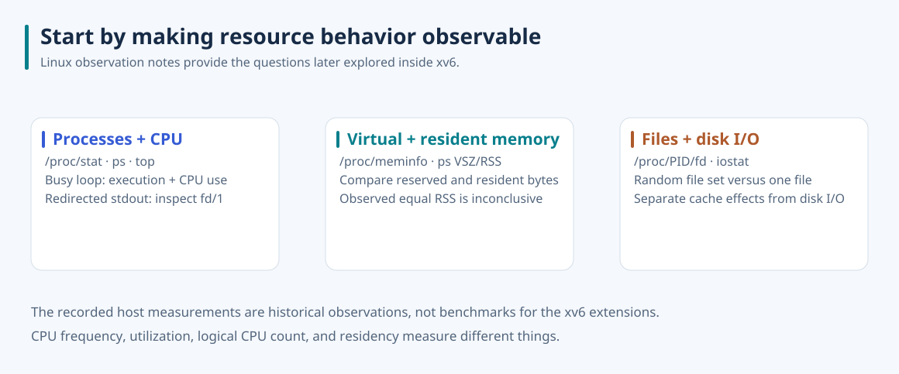

# Observe resources before changing policy

I used small Linux programs and `/proc`, `ps`, `top`, and `iostat` to connect resource behavior with observable state. These notes provide background for the xv6 extensions: process inspection exposes kernel-owned records, frame tracking distinguishes allocation from mapping, scheduling controls service order, and snapshots preserve file state.

## Process state and file descriptors

The recorded busy-loop process appeared in state `R` and consumed about one logical CPU in `top`. Reading `/proc/stat` exposed cumulative process creations and context switches; these counters describe activity since boot, rather than the current number of running processes. The shell launched a separate process for a piped `grep`, and `/proc/<pid>/fd/1` showed stdout redirected to `/tmp/tmp.txt`.

These observations make the user/kernel boundary concrete: the shell builds a process and descriptor arrangement, while the kernel maintains the state that tools can inspect. The later xv6 `get_procinfo` interface returns a small record from that state; the separate lseek extension makes file position explicit. Neither was implemented by this Linux observation exercise.

## Virtual memory is not residency

Two programs reserved a large local integer array; one also wrote array elements. The saved `ps` output showed VSZ values of 6,464 and 6,468 KiB, with RSS 5,184 KiB for both. That particular observation does not demonstrate a residency increase from touching the array. Stack layout, compilation, and measurement timing can affect the result, and reproducing demand paging needs a controlled allocation/touch experiment.

This distinction motivates keeping separate questions in the xv6 observatory: a frame's allocation record, the hardware page-table mapping, and the IPT's derived reverse mapping describe different parts of memory state.

## File access and device activity

The recorded programs repeatedly opened either a randomly chosen member of a 5,000-file set or one fixed file. The report recorded a device-utilization sample of 44.40% in the random-file run and 1.23% in the fixed-file run. These are historical samples from that environment. Cache residency, the file set, device behavior, and observation intervals were not controlled sufficiently to turn them into a general performance ratio.

They establish a useful question for the filesystem work: which operation requires new disk work, and which can reuse existing state? The snapshot implementation answers that at block level by sharing unchanged contents and copying a shared block when the live file changes.

## Reading the original observations accurately

The report records 18 logical processors and approximately 7,917,220 KiB visible in `/proc/meminfo`. A CPU MHz field is a clock-frequency observation, not a CPU utilization percentage; in a virtualized environment, visible memory and CPU count describe the guest's view rather than necessarily the host's physical configuration.

The observation report contains command/output screenshots, with no standalone call graph. Its Word file and screenshots remain outside this repository. The explanatory SVG is newly drawn, with outlined Noto Sans and the included [font license](assets/NotoSans-OFL.txt). The small Linux program sources are not part of these xv6 submodules, so these notes preserve context and recorded findings without presenting them as runnable repository fixtures. Return to the [kernel extensions overview](../README.md).
